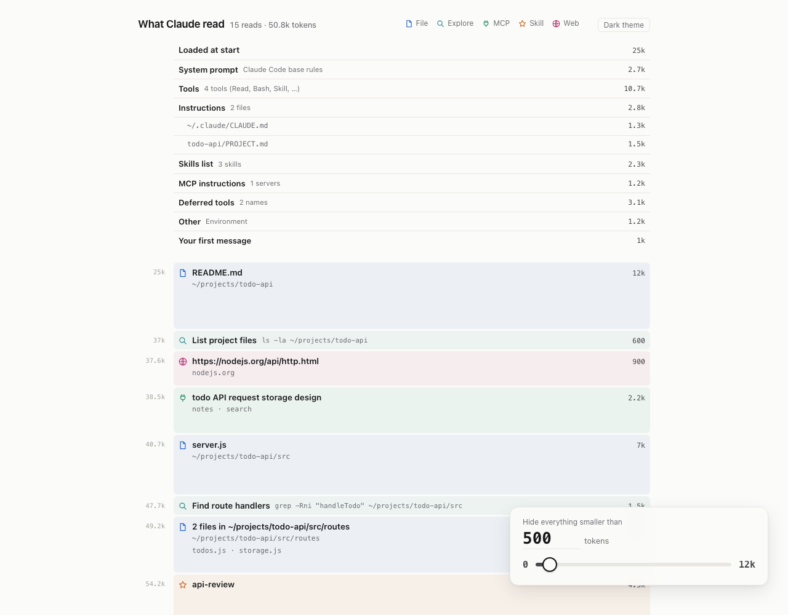

# BSD InspectMySession (`bsd-ims`)

**See what fills a Claude Code session's context window, and where each answer came from. Made to work on Windows.**

BSD InspectMySession is an unofficial utility for inspecting Claude Code sessions. It is not affiliated with or endorsed by Anthropic.

It reads one local session transcript and builds one local page: what loaded at session start (system prompt, tools, CLAUDE.md files, skills, MCP), then every file, search, MCP result, skill and web page the session read, sized by real token use.

## Credit and relationship to upstream

This project is a derivative of [show-context](https://github.com/bernatsampera/show-context) by its contributors (version 0.2.1, MIT license). Nearly all of the code is theirs. This fork renames the command and adds the changes listed below; it is not the original project and is not endorsed by its author. The upstream license and copyright notice are kept in [LICENSE](LICENSE).

To pick up upstream fixes in a clone: `git remote add upstream https://github.com/bernatsampera/show-context` (if not already set), then `git fetch upstream` and `git merge upstream/master`.



*Screenshot from the upstream project. It does not show the per-tool rows added here.*

## What is different from upstream

- **Opens the page on Windows and Linux.** Upstream called the macOS `open` command. `bsd-ims` uses `rundll32` on Windows, `open` on macOS and `xdg-open` elsewhere.
- **Finds the session for the current folder on Windows.** Project folders are matched with every non-alphanumeric character of the path replaced by `-` (for example `C:\projects\sdlc` → `C--projects-sdlc`). Upstream only replaced `/` and `.`.
- **No console window flash** when the live server starts on Windows.
- **Per-tool sizes.** The Tools part of the start-up view lists every tool with its own size.
- **PowerShell session picker** (`scripts/windows/sc-sessions.ps1`).
- **Transcript contract and checker** (`contract/`) that tell you when a Claude Code update changes the transcript format.
- The command is `bsd-ims`, so it installs next to `show-context` without a clash. The environment variables keep their `SHOW_CONTEXT_*` names, and the default output folder is still `~/.cache/show-context/`.

## Status

The automated tests pass on Linux. The Windows changes (opening the page, matching the current folder, the hidden server window) are not yet confirmed on Windows; the PowerShell picker has been used on Windows 10 with PowerShell 7.

## Install (Windows)

Requires Node.js 22 or later. No dependencies.

```powershell
npm install -g https://github.com/Bsd-AI-Dev/BSD-InspectMySession/archive/refs/heads/main.tar.gz
```

This downloads the latest `main` from GitHub; git is not needed. Run the same command again to update, and `npm uninstall -g bsd-ims` to remove it. Check with `bsd-ims --version`.

Or, for development, from a clone:

```powershell
git clone https://github.com/Bsd-AI-Dev/BSD-InspectMySession
cd BSD-InspectMySession
npm link
```

The package is not published on npm.

## Use

### Session picker (PowerShell)

```powershell
& "$(npm root -g)\bsd-ims\scripts\windows\sc-sessions.ps1"
```

(From a clone: `pwsh -File scripts\windows\sc-sessions.ps1`.)

Lists every session, newest first. Type to filter, Up/Down to move, Enter for the action menu (open live, static report, copy URL, show transcript). Tab switches between all folders and the current folder, F3 filters by source (VS Code or terminal), F2 lists and stops running servers. Run `Get-Help` on the script with `-Detailed` for the options (`-SkipPreflight`, `-Scope`, `-Days`, `-Port`, `-IdleHours`, `-NoBrowser`, `-DumpFirstRecord`).

The picker sets `SHOW_CONTEXT_CLAUDE_BIN` to the native `claude.exe` it finds, runs `bsd-ims` from the session's original folder, and opens the URL in your browser.

### Command line

```powershell
bsd-ims <session-id-or-prefix>
```

Without an id it uses `CLAUDE_CODE_SESSION_ID` if set, otherwise the newest session started in the current folder.

| Option | What it does |
| --- | --- |
| `--no-open` | Print the live URL, don't open the browser |
| `--static` | Write a static page, no local server (*Where did this come from?* does not work there) |
| `--help` | Show all options and environment variables |
| `--version` | Show the version |

### Environment variables

| Variable | Meaning |
| --- | --- |
| `SHOW_CONTEXT_OUT` | Output file. Default `~/.cache/show-context/show-context.html` |
| `SHOW_CONTEXT_PROJECTS` | Claude projects folder. Default `~/.claude/projects` |
| `SHOW_CONTEXT_PORT` | Port of the live server. Default: a random free port |
| `SHOW_CONTEXT_IDLE_MS` | Live server idle timeout. Default 30 minutes |
| `SHOW_CONTEXT_CLAUDE_BIN` | Claude Code binary for *Where did this come from?*. Default `claude`. On Windows, point it at `claude.exe`: Node cannot start a `.cmd` shim |

## Privacy and how it works

- It reads one local session transcript and never changes it.
- The page is a single self-contained HTML file. The optional server binds to `127.0.0.1` only, and every route needs a random 32-byte token.
- Token counts come from the real input token use of each model call. When several items enter one call together, the increase is split by their character count.
- **Only *Where did this come from?* uses the network.** It runs your local Claude Code CLI on a fork of the session with no tools, and costs tokens like any Claude Code call. The fork is not saved, and your session stays untouched.

## Transcript checker

`bsd-ims` depends on Claude Code's transcript format, which is not documented and can change. `contract/transcript-contract.json` lists every field, record type, attachment type, tool name, text marker and `claude` CLI flag the code relies on, and what breaks if it changes. `contract/check-transcript.mjs` checks real transcripts against it, runs the parser on them, and checks `claude --help` for the flags the ask feature uses.

The checker is not part of the installed package. Run it from a clone, or download the source without git:

```powershell
cd $env:TEMP
Invoke-WebRequest https://github.com/Bsd-AI-Dev/BSD-InspectMySession/archive/refs/heads/main.tar.gz -OutFile bsd-ims-src.tar.gz
tar -xzf bsd-ims-src.tar.gz
cd BSD-InspectMySession-main
node contract/check-transcript.mjs --latest 5
```

(In a clone, `npm run check -- --latest 5` does the same.) Exit code 0 means OK, 1 warnings, 2 failures.

- **First run:** the checker lists record, attachment, block and tool types it does not know as INFO. Look at them once. If there are no FAIL lines and nothing looks important, run it again with `--stamp`. That records the Claude Code version and marks those types as reviewed, so later runs only show new changes.
- `--fix-prompt` prints a ready-made prompt that describes the problems for Claude Code.
- Other options: `--json`, `--no-parse`, `--no-cli`, `--projects`, `--src`, `--contract`. See `--help`.

### When Claude Code updates

1. Run `node contract/check-transcript.mjs --latest 5`.
2. If it reports WARN or FAIL, run it again with `--fix-prompt` and give the output to Claude Code in this repository.

## Limits

- It depends on an unofficial transcript format, which can change without notice. Use the checker above.
- Subagent reads are not shown.
- Per-tool sizes are estimates: the measured Tools total is split by the length of each tool's definition. The Instructions breakdown uses the same method.
- The Tools and System prompt parts need `api-request-shape` records in the transcript. Sessions without them show *Not recorded in this session file* instead.
- `Grep` and `Glob` tool results are not counted as reads.
- *Where did this come from?* works with Claude Code only.

## License

MIT. See [LICENSE](LICENSE). The original copyright notice of show-context is kept; changes in this fork are additionally copyright Bsd-AI-Dev.
