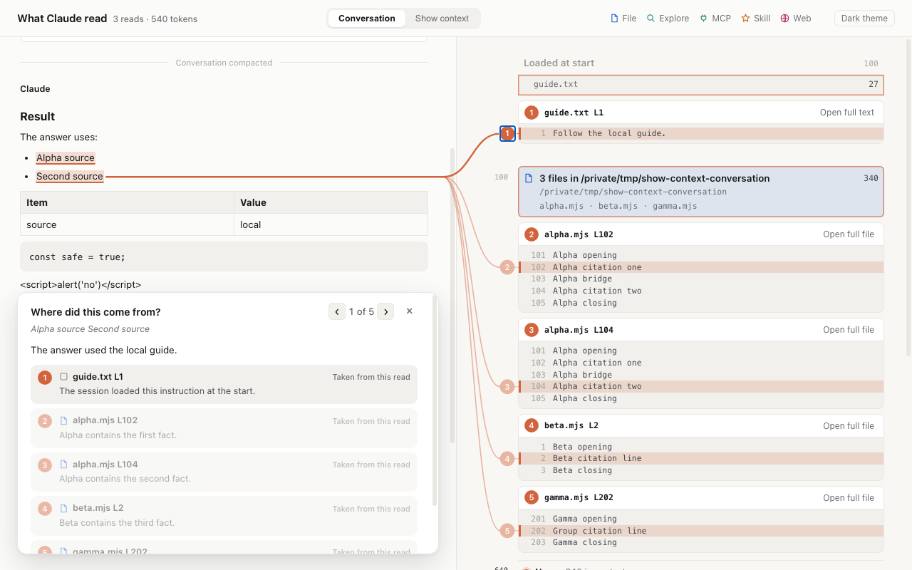

# show-context

show-context creates one local page for a Claude Code session.




## What the page shows

The page has Conversation and Show context modes.
Conversation shows the main thread, assistant Markdown, and folded tool calls.
Select assistant text to ask where it came from.
Select text in a tool row to ask why the call was made.
The answer opens a split view and connects exact source passages with numbered lines.

Show context keeps the context view from version 0.1.
It shows the parts loaded at the start of the session.
It then shows each read in order.
The block height grows with the read size.
Each color identifies File, Explore, MCP, Skill, or Web content.
Select a row to see its full text.
The size filter hides rows smaller than 2,000 tokens by default.

## Install

Install the command with npm.

```text
npm install -g show-context
```

You can also run it without an install.

```text
npx show-context
```

Install it from source.

```text
git clone https://github.com/bernatsampera/show-context.git
cd show-context
npm link
```

Node.js 24 or later is required.

## Use

Run this command inside Claude Code.

```text
! show-context
```

Run this command in a terminal to select a session by ID or prefix.

```text
show-context <session-id-or-prefix>
```

Use `--no-open` to print the live URL without opening it.
Use `--static` to write and open a static page without a server.
Set `SHOW_CONTEXT_OUT` to select another output file.
Set `SHOW_CONTEXT_PROJECTS` to select another Claude projects folder.
The old `CONTEXT_LENS_ROOT` name still works as a fallback.
Set `SHOW_CONTEXT_PORT` to select a server port.
Set `SHOW_CONTEXT_IDLE_MS` to change the idle timeout in milliseconds.
Set `SHOW_CONTEXT_CLAUDE_BIN` to select another Claude Code CLI binary.

The default output is `~/.cache/show-context/show-context.html`.
The live server exits after 30 minutes without a request.

## How it works

The command reads one local transcript.
It writes a complete static page.
By default, it also starts a detached local server and exits at once.
The server binds only to `127.0.0.1`.
The URL contains a random 32-byte token.
Every server route requires that token.
The command does not change the Claude projects folder.

The command measures input tokens from each model call.
This value is exact for that call.
When several items enter the call together, the command divides the increase by the character count of each item.

Reads include files, shell file reads, shell searches, MCP reads, skills, and web results.
Writes, edits, and run commands are not reads.
The page keeps all CSS, JavaScript, data, and icons in one local HTML file.

Asking runs the local Claude Code CLI on a fork of the session.
The fork has no tools and does not save a session.
The original session does not change.
That Claude Code call uses the network and costs tokens like any other Claude Code call.
Everything else stays local.

## Limits

The parser depends on the Claude Code transcript format.
That format can change.
The page does not show subagent reads.
Asking supports Claude Code only for now.

## License

MIT
